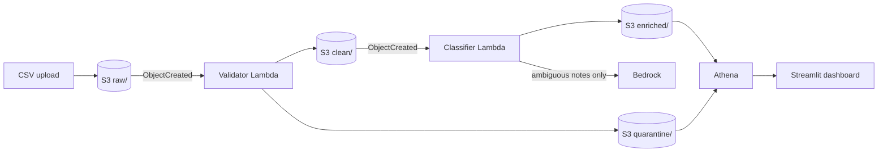

# Commissioning Issue Analytics Pipeline

Event-driven AWS pipeline that validates, classifies and reports on data centre commissioning issue logs: the equipment, contractor and manufacturer issues raised while bringing new capacity online.

Upload a CSV of issues and the pipeline validates every row, quarantines bad records with a reason, classifies each issue's root cause (cheap rules first, Bedrock only for ambiguous notes), and makes everything queryable in Athena behind a Streamlit dashboard. Both Lambdas ship through CodeDeploy canary releases with alarm-based automatic rollback.



## Design

| Concern | Approach |
|---|---|
| Validation | Schema, enum, ID format, date parsing and ordering, status/closure consistency, duplicate IDs. Bad rows go to `quarantine/` with machine-readable reasons; a file missing columns is quarantined whole rather than crashing. |
| Error handling | Async retries (2), SQS dead-letter queue per function, adaptive retries on Bedrock throttling, malformed LLM output falls back to `unclassified` instead of failing the batch. |
| Cost | Keyword rules classify roughly 75% of generated issues for free (29% of the hand-written evaluation set, see below); only ambiguous notes reach Bedrock, batched 20 per call with short structured JSON output. Athena uses partition projection and a 1 GB per-query scan cutoff. Optional AWS Budgets alert. |
| Release safety | Each Lambda has a `live` alias. CodeDeploy shifts 10% of traffic to a new version for 5 minutes, then 100%; a CloudWatch errors alarm on the alias triggers automatic rollback. |
| Observability | Both functions emit CloudWatch Embedded Metric Format counts (valid, quarantined, classified by rules / LLM / fallback). |
| Infrastructure | AWS CDK (Python); S3 is private, encrypted, SSL-only. GitHub Actions runs lint, tests and synth on every push, and deploys via OIDC when enabled. |

Root-cause categories: `equipment_defect`, `installation_workmanship`, `design_issue`, `controls_integration`, `documentation`.

## Evaluation

`eval/labelled_notes.csv` holds 70 hand-written, hand-labelled notes (14 per category), phrased independently of the generator templates so the rules are not graded on the text they were written from.

```bash
PYTHONPATH=src/classifier python scripts/evaluate.py          # rules only, no AWS needed
PYTHONPATH=src/classifier python scripts/evaluate.py --llm    # rule misses go to Bedrock; reports tokens and cost per 1,000 issues
```

| Mode | Accuracy | Rules coverage | Rules precision | Cost per 1,000 issues |
|---|---|---|---|---|
| Rules only | 27% | 29% | 95% | $0 |
| Rules + Nova Micro | 79% | 29% | 95% | ~$0.005 |
| Rules + Nova Lite | 93% | 29% | 95% | ~$0.007 |
| **Rules + Nova 2 Lite** (default) | **94%** | 29% | 95% | ~$0.056 |

Costs use ap-southeast-1 on-demand token prices. The rules are precise but narrow: on realistic phrasing most issues fall through to the model, so the free share is far lower than on synthetic data. Nova Lite matches Nova 2 Lite within one note at an eighth of the cost; switch with `-c model_id=apac.amazon.nova-lite-v1:0`.

## Layout

```
app.py, cdk.json          CDK entry point and config
infra/stack.py            All infrastructure
src/validator/            Validator Lambda
src/classifier/           Rules + Bedrock classifier Lambda
scripts/generate_data.py  Synthetic issue log generator
scripts/evaluate.py       Accuracy and cost against eval/labelled_notes.csv
dashboard/app.py          Streamlit dashboard on Athena
tests/                    Unit tests and CDK template assertions
```

## Run locally

```bash
python -m venv .venv && source .venv/bin/activate
pip install -r requirements-dev.txt
pytest -q
python scripts/generate_data.py --rows 500 --bad-rate 0.05
```

Tests need Node.js installed (the CDK library uses it under the hood).

## Deploy

Prerequisites: an AWS account, AWS CLI configured, Node.js, and `npm install -g aws-cdk`.

1. **Enable Bedrock model access** in the console for your region. The default model is Amazon Nova 2 Lite through its global inference profile (`global.amazon.nova-2-lite-v1:0`); any Bedrock Converse model works via `-c model_id=<id>` (Claude 5 models are called at low effort). To skip Bedrock entirely and run at zero model cost, deploy with `-c llm_enabled=false`: ambiguous issues are then marked `unclassified` and the classifier gets no Bedrock permissions.
2. Bootstrap once: `cdk bootstrap`
3. Deploy, with a budget alert: `cdk deploy -c budget_email=you@example.com -c budget_usd=10`
4. Note the `BucketName` output, then upload data:
   ```bash
   aws s3 cp data/issues_YYYYMMDD.csv s3://<BucketName>/raw/
   ```
5. Run the dashboard:
   ```bash
   pip install -r dashboard/requirements.txt
   streamlit run dashboard/app.py
   ```

Tear down with `cdk destroy` (the bucket and its contents are deleted).

### Seeing a canary rollback

Change anything in `src/validator/validator.py` and redeploy: CodeDeploy runs the canary, visible under CodeDeploy > Deployments. To watch a rollback, make the handler raise an exception, deploy, then upload a CSV during the 5-minute window. The errors alarm fires and traffic returns to the previous version.

### CI deploys

The `deploy` job runs on pushes to `main` only when the repository variable `DEPLOY_ENABLED` is `true`. It assumes an IAM role via GitHub OIDC; store the role ARN in the `AWS_DEPLOY_ROLE_ARN` secret and create a `production` environment for manual approval.

## Cost

At demo scale (a few thousand issues a month) the running cost is cents: Lambda and S3 sit within the free tier, Athena scans kilobytes, and only the ambiguous minority of issues reach Bedrock. Set the budget alert anyway.

## Data

All data is synthetic, generated by `scripts/generate_data.py`. Sites, manufacturers and contractors are fictional. The generator deliberately injects malformed rows (bad enums, invalid dates, closed-before-opened, duplicates) to exercise validation.
