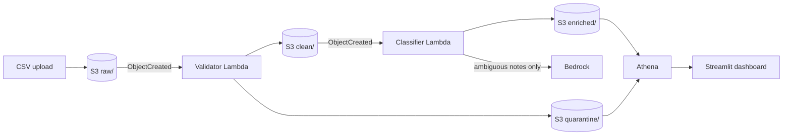
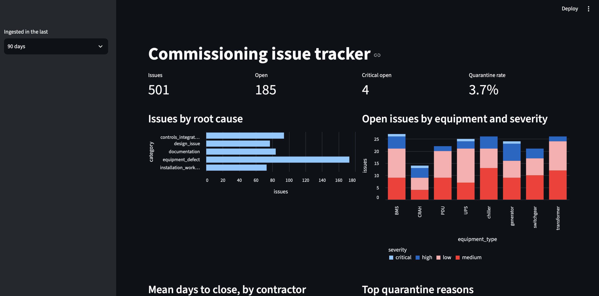
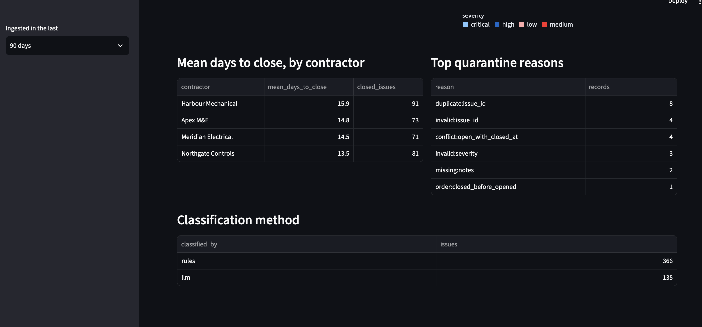
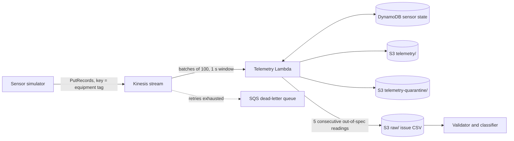
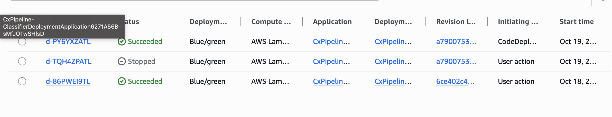
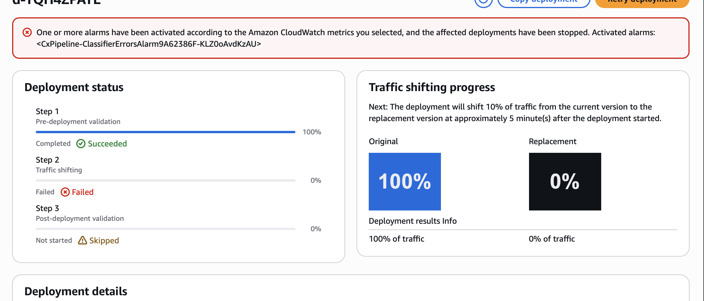
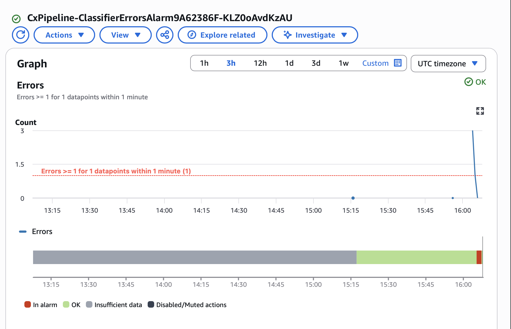
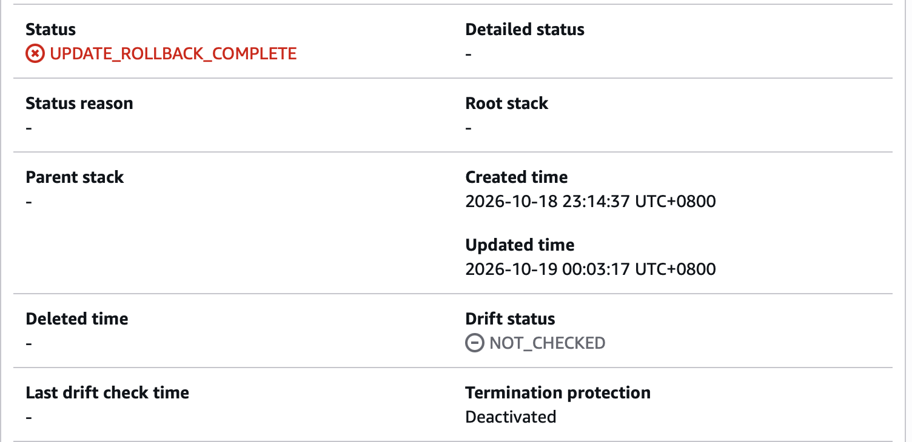

# Cloud-Native Commissioning Data Pipeline (AWS)

Event-driven AWS pipeline that validates, classifies and reports on data centre commissioning (Cx) issue logs: the equipment, contractor and manufacturer issues raised while bringing new capacity online. It runs on synthetic issue logs modelled on real Cx workflows (see [Data](#data)).

Upload a CSV of issues and the pipeline validates every row, quarantines bad records with a reason, classifies each issue's root cause (cheap rules first, Bedrock only for ambiguous notes), and makes everything queryable in Athena behind a Streamlit dashboard. Both Lambdas ship through CodeDeploy canary releases with alarm-based automatic rollback.





<details><summary>Dashboard tables: days to close by contractor, quarantine reasons, classification method</summary>



</details>

## Design

| Concern | Approach |
|---|---|
| Validation | Schema, required fields, ID format, allowed values, date parsing and ordering, status/closure consistency, notes length, duplicate IDs. Bad rows go to `quarantine/` with machine-readable reasons; a file missing columns is quarantined whole rather than crashing. |
| Error handling | Lambda retries a failed run twice, then sends the event to an SQS dead-letter queue (one per function); Bedrock calls use adaptive client retries on throttling; malformed LLM output falls back to `unclassified` instead of failing the batch. |
| Cost | Keyword rules classify about 73% of generated issues for free (29% of the hand-written evaluation set, see below); only ambiguous notes reach Bedrock, batched 20 per call with short structured JSON output. Athena uses partition projection and a 1 GB per-query scan cutoff. Optional AWS Budgets alert. |
| Release safety | Each Lambda has a `live` alias. CodeDeploy shifts 10% of traffic to a new version for 5 minutes, then 100%; a CloudWatch errors alarm on the alias triggers automatic rollback. Before any classifier traffic shifts, a quality gate Lambda scores the new version on 20 labelled notes and fails the deployment below 80% accuracy, catching releases that run cleanly but classify badly. |
| Observability | Both functions emit CloudWatch Embedded Metric Format counts (valid, quarantined, classified by rules / LLM / fallback). An SNS topic emails alerts when a release trips its errors alarm, when events land in a dead-letter queue, or when more than 5% of uploaded rows are quarantined in a 5-minute window. |
| Infrastructure | AWS CDK (Python); S3 is private, encrypted, SSL-only. GitHub Actions runs lint, 80 tests (including a fault-injected stream soak test) and `cdk synth` on every push; an optional deploy job (after tests and synth pass) uses OIDC and is off by default. |

Root-cause categories: `equipment_defect`, `installation_workmanship`, `design_issue`, `controls_integration`, `documentation`.

## Evaluation

`eval/labelled_notes.csv` holds 70 labelled notes (14 per category), written independently of the generator templates so the rules are not graded on the text they were written from.

```bash
PYTHONPATH=src/classifier python scripts/evaluate.py          # rules only, no AWS needed
PYTHONPATH=src/classifier python scripts/evaluate.py --llm    # rule misses go to Bedrock; reports tokens and cost per 1,000 issues
```

| Mode | Accuracy | Rules coverage | Rules precision | Cost per 1,000 issues |
|---|---|---|---|---|
| Rules only | 27% | 29% | 95% | $0 |
| Rules + Nova Micro | 79% | 29% | 95% | ~$0.005 |
| Rules + Nova Lite | 93% | 29% | 95% | ~$0.007 |
| **Rules + Nova 2 Lite** (default) | **93-94%** | 29% | 95% | ~$0.056 |

Costs use ap-southeast-1 on-demand token prices; model accuracy varies by about one note between runs, and with 70 notes each figure carries roughly ±6 points of uncertainty. The rules are precise but narrow: on realistic phrasing most issues fall through to the model, so the free share is far lower than on synthetic data. Nova Lite matches Nova 2 Lite within one note at an eighth of the cost; switch with `-c model_id=apac.amazon.nova-lite-v1:0`.

## Streaming telemetry (optional)

Issue logs arrive in batches, but commissioning also produces a continuous stream: BMS trend data from CRAHs and chillers during functional and integrated systems testing. With `-c streaming=true` the stack adds a second, always-on path that ingests simulated sensor readings and turns sustained out-of-spec readings into Cx issues, which then flow through the batch pipeline above like any uploaded issue.



| Concern | Approach |
|---|---|
| Ordering | Partition key is the equipment tag, so each sensor's readings stay in order on one shard. |
| Bad records | Malformed JSON, missing fields, non-numeric or physically impossible values go to `telemetry-quarantine/` with reasons and never fail the batch, so one poison record cannot block a shard. |
| Partial failures | The consumer reports the lowest sequence number it could not commit (`ReportBatchItemFailures`), writes only the records before it, and Lambda retries from there. Up to 10 retries with batch bisection, then batch metadata goes to an SQS dead-letter queue (records stay replayable from the stream for 24 hours). |
| Idempotency | Output keys are derived from shard and first sequence number, so a retried batch overwrites rather than duplicates. Per-sensor state carries a timestamp watermark and is written with a conditional update, so replays and producer duplicates never double count; an issue's ID and key are derived from the excursion's start, so it is raised once even if the state write after it fails. |
| Producer | Batches up to 500 records per `PutRecords` and resends only the entries Kinesis rejected, with jittered backoff. |
| Observability | Per-batch metrics for readings, quarantined, duplicates, issues raised, retried records and end-to-end latency (event time to processing, as a distribution for p50/p99). Alarms on iterator age above 60 s for 3 minutes and on dead letters, both to the alerts topic. Athena tables `telemetry` and `telemetry_quarantine`. |

### Testing the stream

The load test runs the real consumer against either an in-memory Kinesis that mimics an event source mapping (shard routing, checkpoints, retry from the reported failure, dead-lettering) or the deployed stack. It injects bad records, producer duplicates, throttled puts and failing consumer writes, then checks the output against the simulator's ground truth: every valid reading stored (or accounted for in the dead-letter queue), every bad record quarantined, and exactly one issue per sustained excursion.

```bash
export PYTHONPATH=src/telemetry:scripts
python scripts/stream_loadtest.py local --duration 600 --sensors 50 --fail-rate 0.2 --throttle-rate 0.05 --shards 2
python scripts/stream_loadtest.py live --duration 300 --sensors 20 --hz 2           # after deploying with streaming
python scripts/stream_loadtest.py live --duration 300 --fail-rate 0.2               # same, with 20% of consumer writes failing
```

Local run, 10 simulated minutes of 50 sensors (30,265 records) with 5% of puts throttled and 20% of consumer writes failing: 1,630 throttled puts resent with none dropped, 478 of 948 batches partially failed and were retried, none dead-lettered, all 29,386 valid readings stored with no retry duplicates, all 614 bad records quarantined, and 84 issues raised for 84 excursions. Live mode additionally reports throughput, latency percentiles and maximum iterator age from CloudWatch. A smaller version of the local run is part of the test suite.

### Streaming cost

Streaming is off by default because a provisioned shard bills by the hour whether or not data flows: about $0.02 per shard-hour (roughly $13 a month left running), plus a small per-million PUT charge. Deploy it for a test session and remove it afterwards with a normal `cdk deploy` (without the flag). Lambda's polling of the stream is free; DynamoDB is on-demand and only written when a sensor's excursion state changes. SQS was considered and rejected: it has no replay and no per-key ordering, both of which the excursion logic relies on.

## Layout

```
app.py, cdk.json          CDK entry point and config
infra/stack.py            All infrastructure
src/validator/            Validator Lambda
src/classifier/           Rules + Bedrock classifier Lambda
src/quality_gate/         Pre-traffic accuracy check for classifier releases
src/telemetry/            Kinesis consumer for streamed BMS telemetry (optional)
scripts/generate_data.py  Synthetic issue log generator
scripts/evaluate.py       Accuracy and cost against eval/labelled_notes.csv
scripts/stream_producer.py  Synthetic BMS sensor stream into Kinesis
scripts/stream_loadtest.py  Load and fault test for the stream, in memory or against AWS
eval/labelled_notes.csv   Labelled evaluation notes
dashboard/app.py          Streamlit dashboard on Athena
tests/                    Unit tests and CDK template assertions
```

## Run locally

```bash
python -m venv .venv && source .venv/bin/activate
pip install -r requirements-dev.txt
pytest -q
python scripts/generate_data.py --rows 500 --bad-rate 0.05
```

Tests need Node.js installed (the CDK library uses it under the hood).

## Deploy

Prerequisites: an AWS account, AWS CLI configured, Node.js, and `npm install -g aws-cdk`.

1. **Check Bedrock model access** for your account and region (new accounts may need AWS to approve Bedrock first). The default model is Amazon Nova 2 Lite through its global inference profile (`global.amazon.nova-2-lite-v1:0`); any Bedrock Converse model works via `-c model_id=<id>` (Claude 5 models are called at low effort). To skip Bedrock entirely and run at zero model cost, deploy with `-c llm_enabled=false`: ambiguous issues are then marked `unclassified` and the classifier gets no Bedrock permissions.
2. Bootstrap once: `cdk bootstrap`
3. Deploy, with a budget alert and pipeline alerts: `cdk deploy -c budget_email=you@example.com -c budget_usd=10 -c alert_email=you@example.com` (confirm the SNS subscription email AWS sends)
4. Note the `BucketName` output, then upload data:
   ```bash
   aws s3 cp data/issues_YYYYMMDD.csv s3://<BucketName>/raw/
   ```
5. Run the dashboard:
   ```bash
   pip install -r dashboard/requirements.txt
   streamlit run dashboard/app.py
   ```

Tear down with `cdk destroy` (the bucket and its contents are deleted).

### Seeing a canary rollback

Change anything in `src/validator/validator.py` and redeploy: CodeDeploy runs the canary, visible under CodeDeploy > Deployments. To watch a rollback, make the handler raise an exception, deploy, then upload a CSV during the 5-minute window. The errors alarm fires and traffic returns to the previous version.

Measured on the live stack: a deliberately failing classifier received 10% of traffic, 4 of 40 invocations hit it and failed, the errors alarm fired about a minute after the first error, and CodeDeploy moved the `live` alias back to the previous version 10 seconds later: about 70 seconds from first error to full rollback, with no manual action. CloudFormation then reverted the stack. The errors alarm only catches crashing releases; the quality gate (added after this run) covers releases that run cleanly but label issues wrongly. Its 20 samples come from the evaluation set, so it is a regression check rather than an independent accuracy measure.



Bottom to top: the successful canary, the broken release stopped by the alarm, and the rollback deployment CodeDeploy triggered automatically, which put `live` back on the previous version in 2 seconds.

| Canary stopped by the alarm | Errors alarm | Stack reverted |
|---|---|---|
|  |  |  |

### CI deploys

The `deploy` job runs on pushes to `main` only when the repository variable `DEPLOY_ENABLED` is `true`. It assumes an IAM role via GitHub OIDC; store the role ARN in the `AWS_DEPLOY_ROLE_ARN` secret and create a `production` environment for manual approval.

## Live results

Deployed with `cdk deploy` to ap-southeast-1 (Singapore) on 18 October 2026, with Nova 2 Lite as the model. A 500-row synthetic file at a 5% bad rate went from upload to enriched output in about 17 seconds: 481 rows classified (73% by rules, the rest by Nova, none left unclassified) and 19 quarantined (3.8%), most often for duplicate IDs, invalid IDs and open issues with a close date. Dashboard queries scanned about 227 KB each.

## Cost

At demo scale (a few thousand issues a month) the running cost is cents: Lambda and S3 sit within the free tier, Athena scans kilobytes, and only the ambiguous minority of issues reach Bedrock. Set the budget alert anyway.

## Data

All data is synthetic: pipeline input is generated by `scripts/generate_data.py`, and the evaluation notes in `eval/` were written for this project. Sites, manufacturers and contractors are fictional. The generator deliberately injects malformed rows (bad enums, invalid dates, closed-before-opened, duplicates) to exercise validation.
